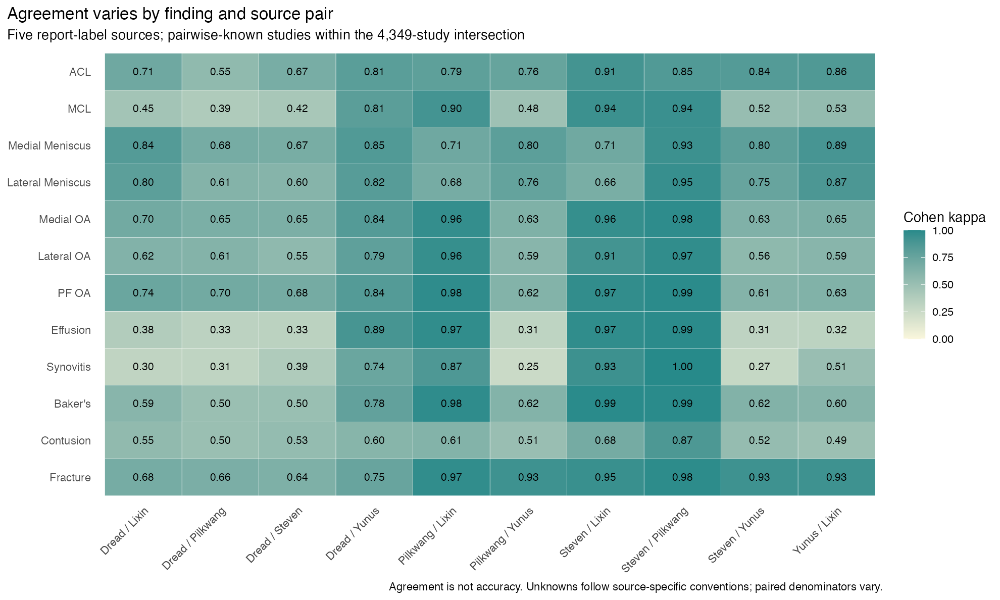
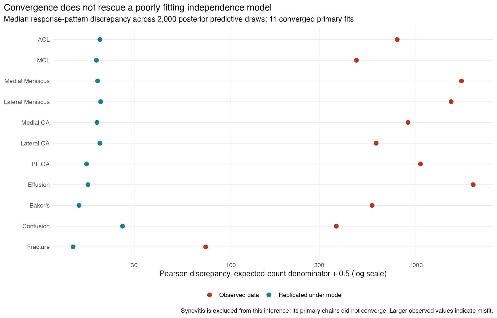

```{r setup, include=FALSE}
library(data.table)
library(knitr)
out <- "../../results/rsna-knee-public"
agree <- fread(file.path(out,"T4_agreement.csv"))
den <- fread(file.path(out,"T4_denominators.csv"))
latent <- fread(file.path(out,"T6_latent_parameters.csv"))
sim <- fread(file.path(out,"T7_simulation.csv"))
order <- fread(file.path(out,"T7_ordering.csv"))
options(knitr.kable.NA="—")
```

## What this study establishes

Five public report-extraction label sources can be aligned on **4,349 studies**, but agreement is strongly finding-dependent. The conditional-independence latent model fails to reproduce their response patterns; one finding also fails convergence. Consequently, this study does **not** endorse its sensitivity or specificity estimates as diagnostic accuracy.

A separate simulation shows why this matters for evaluation: with score-independent errors, the known-parameter AUC correction removes most bias; with score-dependent errors, it overcorrects. Increasing sample size then produces more precise estimates around the wrong target. These are synthetic results under stated assumptions, not performance measurements of any RSNA model.

## Design and provenance

The [SAP v1.2](SAP.md) was frozen at commit `968c2a9cdb3be5978bbeed5128bad8ba843985f9` before B/C outcomes. [DECISIONS.md](DECISIONS.md) records the approved change in emphasis. Empirical leaderboard analysis was discontinued; its already completed synthetic reference appears only in the supplement.

Inputs are Dread v3, Steven v6's original full/v1 file, Pilkwang v1, Yunus v3 and Lixin v1. Each publisher lists CC0. See the [source audit](SOURCE_AUDIT.md) and [file hashes](../../results/rsna-knee-public/source_files.csv). All five primary files cover the Dread-anchored intersection. This is a cohort of study identifiers, not a confirmed count of unique patients.

No original reports, MRI images, official Gold58 annotations, personal model predictions, submission histories or rule-gated files were used. We cannot verify individual copied expert labels or exclude undisclosed panel tuning. Derived releases with known shared ancestry or expert-panel development were not counted as independent sources.

## B: agreement and missingness

Pilkwang YES/NO/UNK verdicts map to positive/negative/missing. Steven's documented 0.5 and Yunus's 0.05/0.5 are missing. Dread and Lixin use a 0.5 score threshold because no special unknown convention is documented. Different thresholds for severity and mention can encode different target constructs. Scores are not assumed calibrated probabilities.

Pairwise analyses use paired known observations; Fleiss kappa and the latent model use studies known in all five sources for each finding. Study bootstrap intervals use 2,000 joint resamples. Repeated examinations cannot be clustered by patient because patient identifiers are unavailable. The intervals may therefore be too narrow. Complete-case selection may be informative.

```{r agreement-table, echo=FALSE, results='asis'}
t <- merge(agree[metric=="fleiss",.(finding,estimate,lower,upper)],unique(den[,.(finding,complete_case_n)]),by="finding",sort=FALSE)
t <- t[match(unique(den$finding),finding)]
kable(t[,.(Finding=finding,`Complete studies`=complete_case_n,`Fleiss kappa`=sprintf("%.3f",estimate),`95% bootstrap interval`=sprintf("%.3f to %.3f",lower,upper))],format="pipe")
```

For example, fracture agreement is high, while synovitis has much lower agreement and only 573 complete studies. These are not comparisons of disease prevalence or imaging accuracy. A high kappa can reflect a shared extraction rule; PABAK and apparent positive fractions are also descriptive.




[T4](../../results/rsna-knee-public/T4_agreement.csv) includes Cohen kappa, PABAK, apparent positive/unknown fractions, Fleiss kappa, and joint/phi correlations of leave-one-source-out majority disagreements. [Source denominators](../../results/rsna-knee-public/T4_denominators.csv) and [paired denominators](../../results/rsna-knee-public/T4_pair_denominators.csv) accompany them. Majority disagreements are **not errors against truth**; shared majority definitions can themselves induce correlation. These summaries do not identify conditional error dependence.

[Prespecified sensitivities](../../results/rsna-knee-public/T4_sensitivity.csv) vary score thresholds to 0.3/0.7 and treat documented unknowns as negative/positive. These change the definition and analyzed population; none was selected to maximize agreement.

## B: what the latent model could not resolve

The model has two latent report-state classes and five conditionally independent Bernoulli indicators. Beta(2,2) accuracy priors and Beta(1,1) prevalence priors are constrained to a positive average Youden index to orient the classes. Four chains start with 6,000 iterations and 2,000 warmup, with one prespecified extension to 12,000/4,000. The [posterior package diagnostics](https://mc-stan.org/posterior/reference/diagnostics.html) use rank-normalized R-hat and bulk/tail ESS. Accuracy-prior sensitivities are Beta(1,1) and Beta(4,2).

Of 12 primary fits, **11 pass** R-hat <1.01 and bulk/tail ESS >=400. Synovitis still fails after extension (maximum R-hat 1.528, minimum bulk ESS 7.1). Its pooled quantiles are saved for diagnostics only and are not valid credible intervals. A more optimistic prior yields converged synovitis chains, which does not justify switching to that prior after observing the failure.

For each of the 11 converged primary fits, **none of 2,000 posterior predictive replicates** reached the observed response-pattern discrepancy. This is a simulation count, not an exact zero probability. The discrepancy is a Pearson-type pattern statistic with expected count +0.5 in the denominator. Many parameters approach their boundaries. Good chain diagnostics cannot establish model fit or identifiability.



The data challenge the combined assumptions of a common binary construct and conditional independence. They do not identify which mechanism explains the mismatch. Shared text, shared extraction conventions and residual source dependence are plausible explanations, not separately estimated causes.

The [parameter-draw summaries](../../results/rsna-knee-public/T6_latent_parameters.csv), [predictive checks](../../results/rsna-knee-public/T6_predictive_checks.csv), and [response-pattern summaries](../../results/rsna-knee-public/T6_pattern_checks.csv) are diagnostic outputs. **No source is declared most accurate, and these posteriors are not used to calibrate C.** A dependent latent model remains an optional extension; it was not fitted. Even a better-fitting report model could not identify the shared discrepancy between reports and imaging truth without additional evidence.

## C: bias, precision and model ordering

This is a prespecified four-cell simulation: n=58/977 and label-error dependence rho=0/0.2. True AUCs are 0.90 and 0.91, prevalence 0.15, Se=Sp=0.85, and paired-score residual correlation 0.8. Rho denotes the latent Gaussian correlation between each score residual and the label-generating residual, conditional on the true class. It is not correlation between diagnostic sources in B. Sample sizes are scenario choices; n=977 is not asserted to be an official test-set count.

Each cell has 2,000 replicates and 399 paired bootstrap resamples per interval. An interval requires at least 80% valid resamples. All cells meet bias MCSE <0.005 for the implemented estimands and methods. [DGM checks](../../results/rsna-knee-public/T7_dgm.csv) report realized marginal parameters.

Under score-independent misclassification,

`AUC_imperfect = 0.5 + (PPV + NPV - 1) × (AUC_true - 0.5)`.

The oracle correction uses the true Se, Sp and prevalence; its scale factor is 0.4698 in this scenario. It does not include uncertainty from estimating these parameters. Corrected AUCs are deliberately not clipped to [0,1]. The expert comparator is a separately generated, perfectly labeled sample of size 58—not actual Gold58.

```{r simulation-table, echo=FALSE, results='asis'}
t<-sim[estimand=="AUC_A" & method!="independent_expert_n58"]
kable(t[,.(n,rho,Method=ifelse(method=="naive","Naive","Oracle correction"),Bias=sprintf("%.4f",bias),`Bias MCSE`=sprintf("%.4f",bias_mcse),`Empirical SD`=sprintf("%.4f",empirical_sd),`95% CI coverage`=sprintf("%.1f%%",100*coverage),`Out of range`=sprintf("%.1f%%",100*out_of_range))],format="pipe")
```

At rho=0, increasing n from 58 to 977 reduces the corrected estimator's SD from **0.1885 to 0.0447**, with little remaining bias. At rho=0.2 and n=977, the same formula has bias **+0.1274** (MCSE 0.0009), only **12.4%** coverage (MCSE 0.74 percentage points), and **75.7%** of corrected AUCs exceed the allowed range. This illustrates model failure, not evidence of an AUC above one.


The independent expert n=58 estimator has little mean bias here, but its percentile-bootstrap coverage is only **84.9–86.5%**, below the nominal 95%. Small positive counts and occasional undefined/failed intervals are part of the result. An unbiased point estimate does not ensure a reliable interval. Full AUC_A, AUC_B and paired-difference bias, RMSE, precision, coverage, failures and MCSEs are in [T7](../../results/rsna-knee-public/T7_simulation.csv); coverage is conditional on a valid interval, and interval failures are reported separately.

At rho=0, strict correct ordering of the 0.90/0.91 models rises from **53.65%** at n=58 to **66.05%** at n=977 (MCSE approximately 1.1 percentage points). Multiplying both estimates by the same positive correction factor cannot change their order; it only rescales the paired difference. [Ordering outputs](../../results/rsna-knee-public/T7_ordering.csv) include ties and reversals. These are two-model simulation probabilities, not actual public/private leaderboard rank-reversal probabilities.


## Boundaries and next analysis

The main deliverable is complete: public-source agreement, independent latent-model diagnostics, and the four baseline misclassification scenarios. Secondary derivative-source analyses, alternate prevalence priors/orientations, a dependent latent model, B-derived extraction-error-only simulations, uncertain-parameter correction, and the large stress grid were not run. The failed independence fit prevents credible calibration from B; no favorable posterior was selected as a substitute.

The next useful extension is a prespecified dependence-aware report-state model with explicit anchors and prior-predictive checks, followed by comparison of predictive fit and parameter stability. It still requires an externally justified target definition before any diagnostic-accuracy interpretation. A broader C grid can examine differential score dependence and uncertain calibration parameters. No additional personal competition materials are needed for these methodological extensions.

## Supplement: completed sampling reference

Before the B/C focus, an A-only synthetic benchmark covered 16 scenarios with 2,000 replicates each. Its baseline SD of a simulated public/private macro-AUC difference was 0.00599 (MCSE 0.00011). [T3](../../results/rsna-knee-public/T3_sampling_benchmark.csv) and the [reference figure](../../figures/rsna-knee-public/F2_sampling_reference_only.png) remain supplementary. No empirical leaderboard scores, excess-variance estimate, selection effect or team ranking were analyzed. The Meta Kaggle extract is no longer required.

## Reproduction and references

See the [R execution guide](README.md), [checks](CHECKS.md), and [SAP references](SAP.md#references). B descriptive computation took 0.11 minutes, latent fitting 1.07 minutes, and C 1.76 minutes on this machine; with the earlier A run, recorded analyses total about 4.22 minutes, within the 120-minute cap. Software tests and rendering are reported separately. Raw/aligned labels, study IDs and sampler/Monte Carlo draws stay outside the repository. Published tables and figures contain aggregates only.
