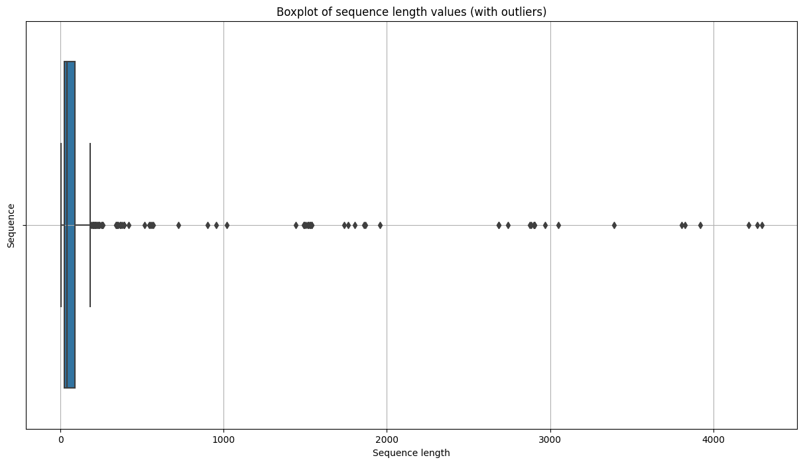

# RNA Sequence and Structure Exploration

My published notebook explores RNA sequence lengths, temporal cutoffs, nucleotide composition and coordinate distributions. A genuine figure has been recovered from the original public output; it is useful for inspecting data heterogeneity, not for judging predictive performance.

## Historical EDA Output

Recovered unchanged from version `226091843`, cell 9, output 0 (zero-based). The long upper tail is a descriptive property of these training sequences. This is an EDA figure, not a validation result. See [output provenance](../../results/README.md).

## Source and Contribution

[Original Kaggle notebook](https://www.kaggle.com/code/handudu/rna-folding-python-eda-submission), version ID `226091843`. Fork of [ChrisK321](https://www.kaggle.com/code/chrisk321/rna-folding-r-eda-submission).

## Running and Interpreting the Archive

The Python notebook contains later R/H2O cells and cannot be run end to end in a Python kernel. Some first-person narrative in the notebook comes from the upstream author, ChrisK321. The recovered EDA figure is descriptive, not model validation.

Inspect [notebook.ipynb](notebook.ipynb) and the original Kaggle Input list before configuring data and dependencies. Historical names, input dependencies and source hashes are retained in [provenance](../../meta/projects/01-rna-folding/provenance.json); shared handling details are in [archive notes](../../docs/ARCHIVE_NOTES.md).
