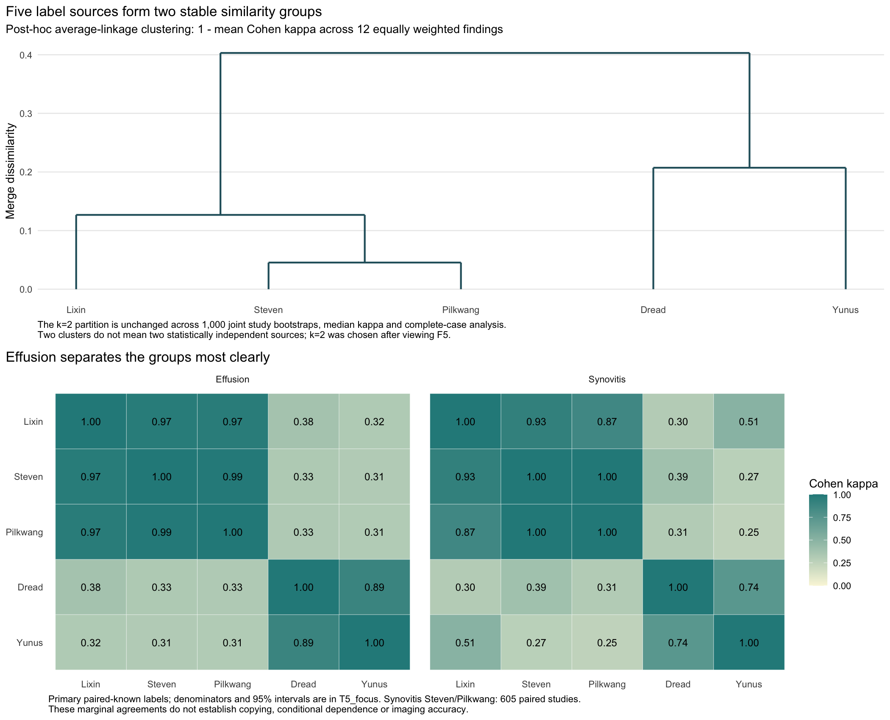
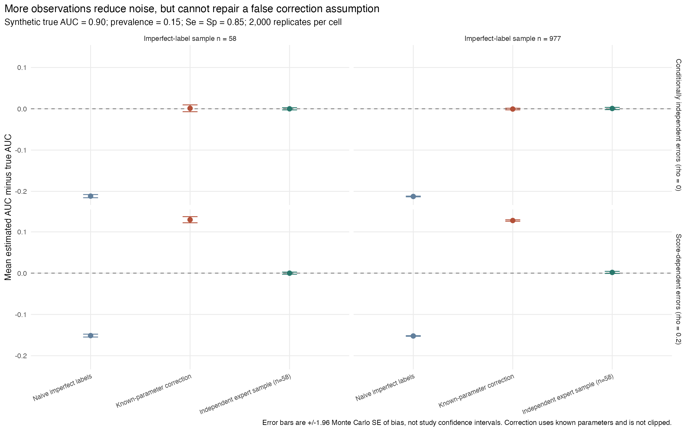

# Knee Diagnostic Labels Without a Gold Standard

**Source agreement, measurement-model checks and AUC misclassification bias**

How should we evaluate diagnoses extracted from radiology reports without an independent reference standard? This R study compares five public label sources on **4,349 knee studies and 12 findings**, then simulates how label errors affect AUC evaluation.

## Three findings

**1. The sources form two stable similarity groups.** Steven/Pilkwang/Lixin cluster together, and Dread/Yunus form the other group. This post-hoc grouping persists across three agreement summaries and 1,000 study-bootstrap resamples. For effusion, within-group Cohen kappa is **0.894–0.989**, versus **0.311–0.377** between groups. Steven and Pilkwang agree perfectly on the **605 paired-known, binary synovitis labels**. Across all sources, fracture has high agreement (Fleiss kappa **0.868**).

Public documentation reveals different operational definitions: an asserted mild finding may count as positive in Pilkwang's verdicts but negative when Yunus's severity score is thresholded at 0.5. This is a plausible contributor to disagreement. High kappa alone cannot prove copying, establish accuracy or reveal how many sources are conditionally independent. The [provenance review](../../analysis/rsna-knee-public/SOURCE_AUDIT.md#post-hoc-provenance-review-2026-10-29) distinguishes the selected original files from documented later blends.

**2. Model checking exposes the limits of estimating accuracy without a gold standard.** A two-class model treating the sources as conditionally independent cannot reproduce the observed label patterns: in each of 11 converged primary fits, none of 2,000 posterior predictive replicates reaches the observed discrepancy. Synovitis also fails convergence. The clustering offers an explanatory lead, while predictive misfit challenges the **combined** assumptions of a common binary target and conditional independence. It does not isolate the cause. Treating the fitted sensitivity/specificity values as established accuracy would therefore be unjustified.

**3. More observations can make a misspecified correction more precisely wrong.** With score-dependent label errors and n=977, known-parameter AUC correction has bias **+0.1274** and nominal 95% interval coverage of **12.4%**. With score-independent errors it removes most bias. These are synthetic scenarios, not measured RSNA model performance.

A post-hoc small-sample check adds a practical lesson: in 4,000 perfectly labeled synthetic samples of n=58, increasing percentile-bootstrap resamples from 399 to 1,999 changes coverage only from **86.1% to 86.5%**. A logit interval reaches **92.6%** among valid intervals (0.625% undefined); ordinary DeLong reaches **83.2%**. More resamples alone do not fix the interval method. See the [full report](../../analysis/rsna-knee-public/report.md) for MCSEs, denominators and paired comparisons.

## Interpretation boundaries

| Evidence | Boundary |
| --- | --- |
| Public-source agreement | Agreement is not imaging accuracy. Unknown codes create different comparison samples; repeated patients cannot be identified. |
| Similarity clustering | Exploratory, added after viewing F5. Two clusters are not an estimate of two independent sources. |
| Latent-model diagnostics | Assess a report-state model; shared report-to-image errors remain unidentifiable. |
| AUC and interval simulations | Assumption-based demonstrations; no actual expert labels or personal model predictions are used. |

## Reproduce and inspect

The [primary SAP](../../analysis/rsna-knee-public/SAP.md) was frozen before B/C outcomes; [DECISIONS](../../analysis/rsna-knee-public/DECISIONS.md) separately records the post-hoc additions. The [R guide](../../analysis/rsna-knee-public/README.md), [aggregate results](../../results/rsna-knee-public/), and [checks](../../analysis/rsna-knee-public/CHECKS.md) provide the execution trail. Only aggregate tables and figures are published; raw labels, IDs and simulation draws remain external.

## Contribution and acknowledgments

I designed and ran this analysis with AI coding assistance. The project's contribution is the comparative analysis, model checking and misclassification simulations. The upstream dataset authors created the label extractions and retain attribution in the [source audit](../../analysis/rsna-knee-public/SOURCE_AUDIT.md).
