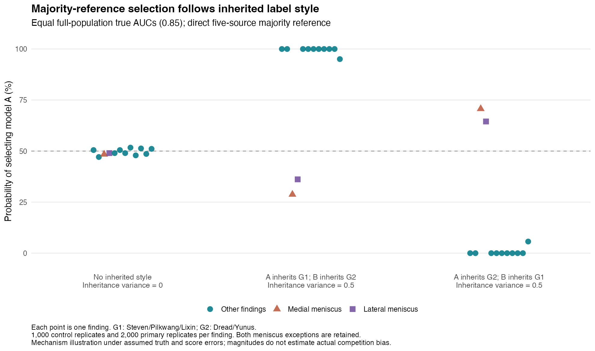

# Knee Diagnostic Labels Without a Gold Standard

How much does disagreement between report-derived labels reflect different definitions, and how can those labels distort model evaluation? I compare five public label sets covering **4,349 knee MRI studies and 12 findings**, then examine specified evaluation mechanisms in simulation.

## Three findings

**1. Definition differences explain most of the disagreement between Pilkwang and Yunus, indicating that the original two-group structure was at least partly shaped by coding.** Initial clustering separated Steven/Pilkwang/Lixin from Dread/Yunus, and latent-model checks showed poor fit. Reviewing documentation identified a concrete mismatch: Yunus's mild code **0.25** had been counted negative under the original **0.5 threshold**, while Pilkwang's YES verdict included affirmed abnormalities. Aligning these two sources on the **same paired cases** raises effusion agreement **60.2% → 99.5%** (κ **0.31 → 0.99**) and synovitis agreement **68.4% → 98.7%**. Only **2/5 sources** document enough detail for this alignment; the other three cannot be confirmed. No new latent-class model was fitted.

**2. Majority-vote references can favour models sharing the majority's labelling style.** With equal true AUCs, direct majority favours the G1-style model in **10/12 findings**, while both meniscus findings favour the other model. Without inherited style, selection is near **50%**; swapping the inherited groups reverses the direction. These controls demonstrate a possible mechanism; its magnitude depends on assumed truth and error inheritance, rather than estimating actual competition bias. Group-agreement filtering discards **8%–41%** of complete cases and can change which model is truly better among retained cases, so it offers no general solution.

**3. Corrections that assume label errors are independent of model scores can fail badly when errors are shared.** In the original score-dependent scenario at n=977, correction using known error parameters has bias **+0.127** and nominal 95% interval coverage of **12.4%**. With independent errors, the same correction removes most bias: more data improves precision without repairing a violated assumption.

## Practical use

Agreement concerns report assertions. The table describes Pilkwang/Yunus after alignment; it does not establish clinical accuracy.

| Finding | Aligned agreement | Paired coverage (n/4,349) | Before use |
| --- | ---: | ---: | --- |
| ACL | 99.2% | 3,887 (89.4%) | Validate against an independent reference. |
| MCL | 99.4% | 3,890 (89.4%) | Specify mild/grade-1 inclusion. |
| Medial Meniscus | 97.0% | 3,990 (91.7%) | Define the report target; adjudicate residual disagreements. |
| Lateral Meniscus | 98.0% | 3,817 (87.8%) | Define the report target; adjudicate residual disagreements. |
| Medial OA | 98.4% | 3,035 (69.8%) | Specify mild OA inclusion. |
| Lateral OA | 97.6% | 2,690 (61.9%) | Specify mild OA inclusion. |
| PF OA | 98.3% | 3,356 (77.2%) | Separate report presence from imaging grade. |
| Effusion | 99.5% | 3,858 (88.7%) | Include trace/mild only when target-appropriate. |
| Synovitis | 98.7% | 599 (13.8%) | Address substantial missingness and mild inclusion. |
| Baker's | 98.8% | 2,195 (50.5%) | Check missingness and selected-sample coverage. |
| Contusion | 91.0% | 2,633 (60.5%) | Review the remaining 9% disagreement. |
| Fracture | 99.4% | 1,485 (34.1%) | Address missingness despite high paired agreement. |

## Limitations

Unknown labels and patient clustering affect coverage and uncertainty; neither agreement nor clustering establishes independent errors or imaging accuracy. Truth and inherited score errors in the simulations are assumptions. The v1.4 extension is exploratory, and its plan files were not fully uploaded before execution ([publication record](analysis/v1.4/FREEZE_DEVIATION.md)).

## Report and reproduction

The [full report](report.md) contains all scenarios, filtering results, denominators and Monte Carlo uncertainty. [R guide](analysis/README.md) · [v1.4 reproduction](analysis/v1.4/RUN.md) · [source audit](analysis/SOURCE_AUDIT.md) · [aggregate results](results/). Original frozen analyses and outputs are retained.
