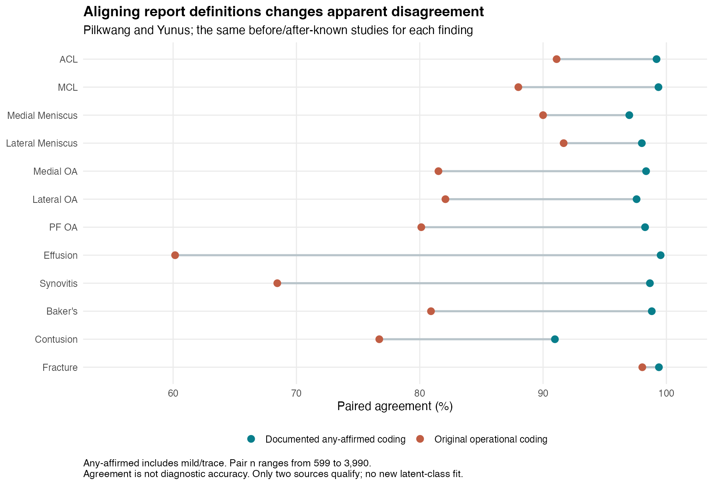
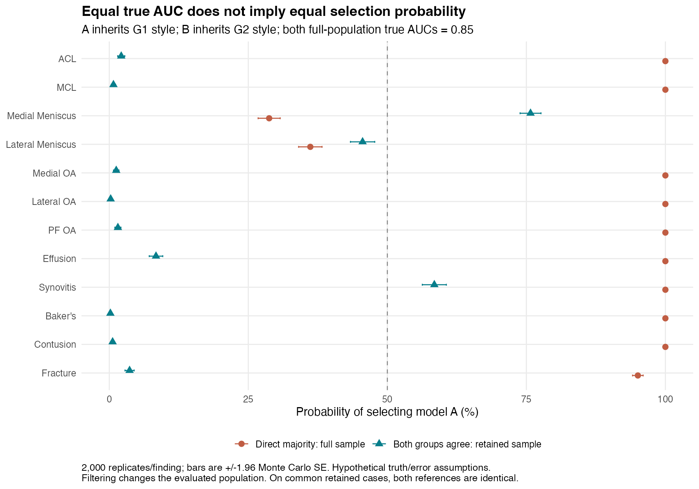
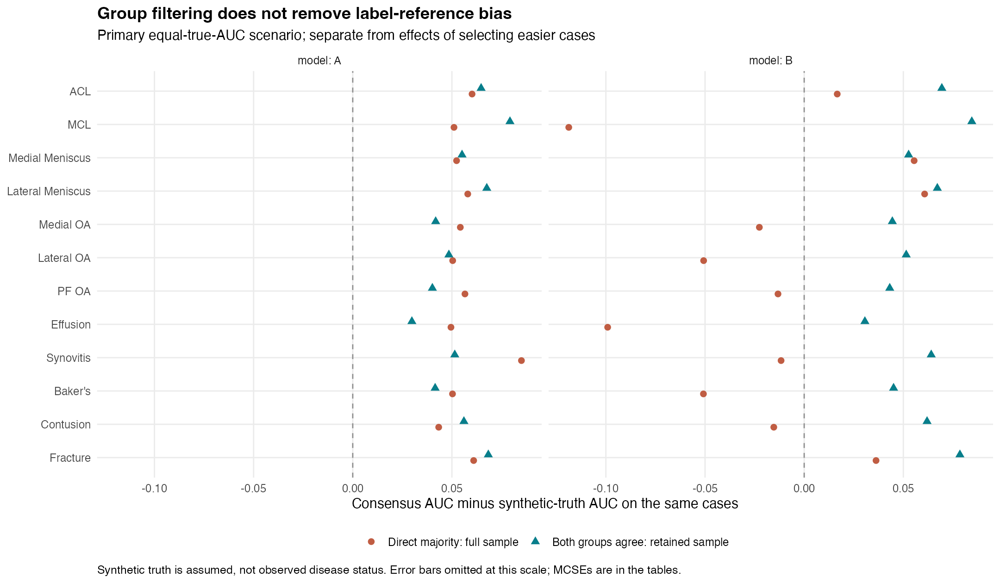
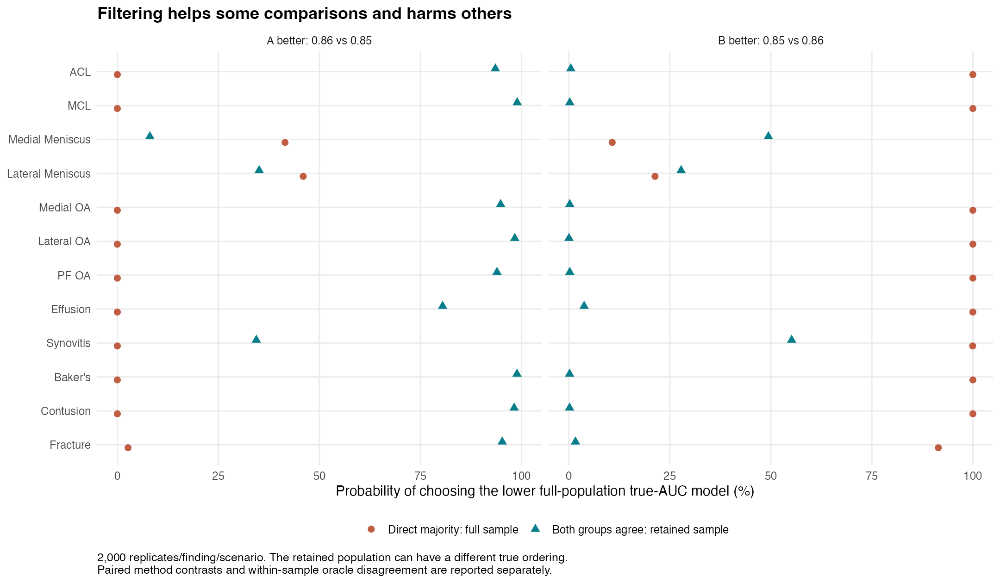

# SAP v1.4 review: definition alignment and consensus-reference model selection

**Exploratory review package, 2026-10-29. Project-page changes await owner review.**

**Protocol-publication deviation:** the first freeze upload was truncated. The complete plan was fixed and checked locally, but was not fully published before analysis. Missing files were repaired after results were known. See [FREEZE_DEVIATION.md](FREEZE_DEVIATION.md).

The useful research question is whether report-extraction labels with different definitions can be pooled and then used to select medical AI models. Five public label sources share 4,349 studies. The new analysis finds a large, directly documented definition effect in the two alignable sources, and shows in calibrated hypothetical simulations why consensus-reference model selection can be misleading. This is a matched comparison of public extraction outputs; it is not a causal natural experiment or an independent clinical validation.

## 1. Intended definitions and what could actually be aligned

The [attempted freeze](https://github.com/Barry81-666/kaggle-portfolio/commit/0053954a94baec9545e6f2e0c88fe43438456d3b) was published at **05:32:34 UTC**, before alignment began at **05:36:31 UTC**, but final remote checks found the transfer incomplete. The scenario and source-document CSVs were present; the full new SAP and standalone map were missing, with 113 mapping rows embedded in a malformed old SAP file. The complete intended files were fixed locally and checked before execution. Their restoration to GitHub occurred after results. Rules came only from cached public descriptions and were not changed in response to outcomes. See [readable mapping](DEFINITION_MAPPING.md), [120-row map](definition-map.csv), [source evidence](source-documents.csv), and [intended SAP](SAP-v1.4.md). All original outcomes had already been seen. This is exploratory work with a documented publication deviation, not a successful complete pre-outcome public freeze.

| Source | Any affirmed abnormality | Moderate or greater | Permitted use |
| --- | --- | --- | --- |
| Pilkwang | YES=1; NO=0; UNK=missing | Not documented | Primary paired agreement |
| Yunus | 0.25/0.55/0.90–1=1; 0=0 | 0.55/0.90–1=1; 0/0.25=0 | Both report targets; 0.05/0.50/undocumented=missing |
| Steven full/v1 | Positive definition not documented | Not documented | Original operational sensitivity/context only |
| Dread | Not documented sufficiently | Not documented | Original operational sensitivity/context only |
| Lixin | Description empty | Not documented | Original operational sensitivity/context only |

There are **two alignable sources** for any affirmed abnormality and **one** for moderate-or-greater, for each of twelve findings. **Zero new latent-class fits were run.** We cannot supply defensible sensitivity/specificity estimates from this two-source alignment. The three incompletely documented sources appear only in labeled non-harmonized context; the separate simulation studies their original operational joint pattern distribution, without claiming to harmonize all five definitions.

The any-affirmed target includes mild/trace findings, excludes explicit denials, and retains unmentioned/uncertain as missing. Three Yunus entries have undocumented numeric codes (one 0.40 and two 0.75); all were excluded under the frozen rule. No threshold was chosen from resulting agreement. The moderate-only Yunus coding gives zero change from the old coding on its fixed known samples; it supports no between-source comparison.

## 2. Observed changes on identical before/after samples

| Finding | Same paired n | Before | After | Change, pp (95% bootstrap interval) | Kappa before → after |
| --- | --- | --- | --- | --- | --- |
| ACL | 3887 | 91.1% | 99.2% | +8.1 (+7.3, +9.0) | 0.756 → 0.980 |
| MCL | 3890 | 88.0% | 99.4% | +11.4 (+10.3, +12.4) | 0.481 → 0.979 |
| Medial Meniscus | 3990 | 90.0% | 97.0% | +7.0 (+5.9, +8.0) | 0.802 → 0.939 |
| Lateral Meniscus | 3817 | 91.7% | 98.0% | +6.3 (+5.4, +7.3) | 0.765 → 0.950 |
| Medial OA | 3035 | 81.5% | 98.4% | +16.8 (+15.4, +18.3) | 0.635 → 0.967 |
| Lateral OA | 2690 | 82.1% | 97.6% | +15.5 (+14.0, +17.0) | 0.593 → 0.950 |
| PF OA | 3356 | 80.1% | 98.3% | +18.1 (+16.7, +19.6) | 0.617 → 0.964 |
| Effusion | 3858 | 60.2% | 99.5% | +39.4 (+37.8, +40.9) | 0.311 → 0.989 |
| Synovitis | 599 | 68.4% | 98.7% | +30.2 (+26.4, +34.0) | 0.252 → 0.916 |
| Baker's | 2195 | 80.9% | 98.8% | +17.9 (+16.3, +19.6) | 0.617 → 0.976 |
| Contusion | 2633 | 76.7% | 91.0% | +14.2 (+12.3, +16.1) | 0.506 → 0.820 |
| Fracture | 1485 | 98.0% | 99.4% | +1.3 (+0.8, +2.0) | 0.928 → 0.978 |

Intervals use 2,000 joint study-bootstrap draws; all change estimates have 2,000 valid draws. Pilkwang's verdict coding is unchanged. The principal change is that Yunus's documented mild code 0.25 becomes positive. For effusion, disagreement falls from 39.8% to 0.5%; for synovitis from 31.6% to 1.3%. This is evidence that these sources were answering different operational questions under the original threshold. High post-alignment agreement does not establish correct diagnosis, independent errors, or generalizability beyond the observed known pairs. Contusion retains the largest residual disagreement, about 9%.

Full positive-fraction changes and known/excluded counts are in [paired changes](../../results/v1.4/alignment-paired-changes.csv) and [denominators](../../results/v1.4/alignment-denominators.csv). [Five-source context](../../results/v1.4/nonharmonized-five-source-context.csv) remains explicitly non-harmonized.

## 3. Frozen simulation scenarios

G1 = Steven/Pilkwang/Lixin; G2 = Dread/Yunus. A inherits G1 style and B G2 style, except in the swap control. No participant model is trained or evaluated. The generator preserves each finding's original five-source-complete **joint label-pattern distribution** in expectation. Hypothetical truth and score-error relationships are added as assumptions; the score construction sets each model's full-population true AUC exactly. Parameters are not taken from the rejected latent fits.

The three primary scenarios are A/B true AUC = **0.85/0.85**, **0.86/0.85**, and **0.85/0.86**, with inheritance variance 0.5, equal group weight in the truth mechanism, truth slope 4, and prevalence multiplier 1. Each has 2,000 replicates per finding. Ten prespecified sensitivities (1,000 replicates each) vary inheritance, swap the inherited group, and vary the assumed truth mechanism/prevalence. See [all 13 scenario rows](SIMULATION_SCENARIOS.md) and [exact generator](SAP-v1.4.md#5-empirically-constrained-simulation-generator).

The population is the original complete-label subset (573–3,987 studies per finding), not all 4,349 reports. The prevalence anchor is a scenario proxy, not an estimate of disease prevalence. Clusters were discovered under the original operational coding; the large alignment effect warns that some apparent cluster structure may reflect definitions. The simulation therefore describes risks of using those **original** labels as a reference, not an inevitable property of a fully harmonized dataset.

## 4. Equal underlying quality: which model gets selected?

Both full-population true AUCs are 0.85, so there is no intrinsically worse model. P(A) measures selection preference. Ref ΔAUC is A minus B against the reference; truth ΔAUC is against simulated truth on the same retained cases. Retained n in the table is the observed calibration count; simulated mean n and MCSE are separately reported in [DGM summaries](../../results/v1.4/simulation-dgm.csv).

| Finding | Complete n | Observed retained n (%) | P(A), full | P(A), retained | Ref ΔAUC, full | Ref ΔAUC, retained | Truth ΔAUC, retained |
| --- | --- | --- | --- | --- | --- | --- | --- |
| ACL | 3873 | 3482 (89.9%) | 100.0% | 2.1% | +0.043 | -0.015 | -0.010 |
| MCL | 3863 | 3375 (87.4%) | 100.0% | 0.8% | +0.170 | -0.026 | -0.021 |
| Medial Meniscus | 3987 | 3388 (85.0%) | 28.7% | 75.8% | -0.003 | +0.004 | +0.002 |
| Lateral Meniscus | 3808 | 3348 (87.9%) | 36.1% | 45.6% | -0.003 | -0.001 | -0.001 |
| Medial OA | 3020 | 2377 (78.7%) | 100.0% | 1.2% | +0.077 | -0.015 | -0.013 |
| Lateral OA | 2665 | 2107 (79.1%) | 100.0% | 0.3% | +0.101 | -0.021 | -0.018 |
| PF OA | 3329 | 2603 (78.2%) | 100.0% | 1.6% | +0.070 | -0.015 | -0.012 |
| Effusion | 3856 | 2262 (58.7%) | 100.0% | 8.4% | +0.149 | -0.009 | -0.008 |
| Synovitis | 573 | 354 (61.8%) | 100.0% | 58.5% | +0.097 | +0.005 | +0.018 |
| Baker's | 2164 | 1602 (74.0%) | 100.0% | 0.2% | +0.101 | -0.023 | -0.020 |
| Contusion | 2453 | 1786 (72.8%) | 100.0% | 0.6% | +0.059 | -0.020 | -0.014 |
| Fracture | 1306 | 1199 (91.8%) | 95.0% | 3.6% | +0.024 | -0.026 | -0.016 |

Direct majority favors the G1-style model in **10 of 12 findings**, but favors B for both menisci. Under the primary effusion scenario, A is selected in all 2,000 direct-majority replicates despite equal true AUC; after retaining only group-agreement cases, A is selected 8.4% of the time. These are results conditional on the specified assumptions, not estimates of actual participant bias. A 100% Monte Carlo result is not proof of certainty.

Filtering retains 58.7%–91.8% of the complete-label subset, hence abstains on 8.2%–41.3%. For effusion it retains 2,262 of 3,856 complete cases; for synovitis 354 of 573, only 8.1% of the original 4,349 studies. G2 ties and between-group disagreement are reported separately in [cohort calibration](../../results/v1.4/simulation-cohort.csv).

**Common-sample result:** on retained cases the five-source majority label and group-agreement label are identical. Their AUCs and chosen models are therefore identical. Exhaustive checks over all 32 patterns and per-draw checks found zero violations. Comparing full versus retained results measures changed case mix and sample size; it is not evidence that a different vote improved the reference on the same cases.

## 5. AUC distortion and filtering's selection effect

The following is mean(reference AUC − synthetic-truth AUC) on identical evaluated cases, in the equal-true-AUC scenario. It isolates label-reference distortion from population selection. Exact MCSEs and valid denominators are in [the complete summary](../../results/v1.4/simulation-summary.csv).

| Finding | Full bias A | Full bias B | Retained bias A | Retained bias B |
| --- | --- | --- | --- | --- |
| ACL | +0.060 | +0.017 | +0.065 | +0.069 |
| MCL | +0.051 | -0.119 | +0.079 | +0.085 |
| Medial Meniscus | +0.052 | +0.055 | +0.055 | +0.053 |
| Lateral Meniscus | +0.058 | +0.061 | +0.068 | +0.067 |
| Medial OA | +0.054 | -0.023 | +0.042 | +0.044 |
| Lateral OA | +0.050 | -0.051 | +0.048 | +0.051 |
| PF OA | +0.057 | -0.013 | +0.040 | +0.043 |
| Effusion | +0.050 | -0.099 | +0.030 | +0.031 |
| Synovitis | +0.085 | -0.012 | +0.051 | +0.064 |
| Baker's | +0.050 | -0.051 | +0.042 | +0.045 |
| Contusion | +0.043 | -0.015 | +0.056 | +0.062 |
| Fracture | +0.061 | +0.036 | +0.068 | +0.079 |

For example, effusion's full-sample reference AUC is biased by about +0.050 for A and −0.099 for B. Filtering reduces this differential but leaves about +0.030/+0.031 label-reference bias. It also changes conditional true AUCs: equal full-population AUC does not require equal performance in the retained subset. The files separately report `selection_effect = truth AUC on evaluated cases − full-population target` and `total_bias = label_bias + selection_effect`; this decomposition was checked per replicate.

## 6. When one model has higher true AUC in the simulated full population

Error here means choosing the lower **full-population** true-AUC model. The retained subset can have a different true ordering, so this is distinct from disagreement with the synthetic-truth ranking on the same realized test sample. Both endpoints, ties, failures and paired contrasts are supplied.

| Finding | A better: full error | A better: retained error | B better: full error | B better: retained error |
| --- | --- | --- | --- | --- |
| ACL | 0.0% | 93.5% | 100.0% | 0.5% |
| MCL | 0.0% | 99.0% | 100.0% | 0.3% |
| Medial Meniscus | 41.5% | 8.1% | 10.8% | 49.4% |
| Lateral Meniscus | 46.0% | 35.1% | 21.3% | 27.8% |
| Medial OA | 0.0% | 94.8% | 100.0% | 0.3% |
| Lateral OA | 0.0% | 98.4% | 100.0% | 0.1% |
| PF OA | 0.0% | 94.0% | 100.0% | 0.3% |
| Effusion | 0.0% | 80.5% | 100.0% | 3.8% |
| Synovitis | 0.0% | 34.4% | 100.0% | 55.1% |
| Baker's | 0.0% | 98.9% | 100.0% | 0.2% |
| Contusion | 0.0% | 98.2% | 100.0% | 0.2% |
| Fracture | 2.6% | 95.2% | 91.5% | 1.7% |

Filtering is not a universal improvement. For effusion, when B's true AUC is 0.86 versus A's 0.85, error falls from 100.0% to 3.8%; when A is better by the same amount, error rises from 0.0% to 80.5%. Some of this reversal reflects a different conditional true ordering after selection. Those counterexamples are part of the result. The [paired contrasts](../../results/v1.4/simulation-paired-contrasts.csv) give paired MCSEs and valid denominators rather than treating the methods' simulations as independent.

## 7. Prespecified sensitivities and precision

| Equal-AUC sensitivity | P(A) range, full | P(A) range, retained | Findings P(A)>50%, full /12 | Retained /12 |
| --- | --- | --- | --- | --- |
| no_inheritance | 47.1%–51.7% | 46.9%–51.5% | 5 | 4 |
| weak_inheritance | 38.9%–100.0% | 3.2%–67.9% | 10 | 2 |
| strong_inheritance | 16.4%–100.0% | 0.0%–80.1% | 10 | 2 |
| swap_training_groups | 0.0%–70.7% | 23.7%–99.7% | 2 | 10 |
| truth_favors_group1 | 26.6%–100.0% | 0.0%–67.6% | 10 | 1 |
| truth_favors_group2 | 34.2%–100.0% | 2.5%–82.0% | 10 | 4 |
| weak_truth_alignment | 35.9%–100.0% | 0.5%–76.0% | 10 | 3 |
| strong_truth_alignment | 23.5%–100.0% | 0.0%–78.1% | 10 | 2 |
| lower_prevalence | 32.5%–100.0% | 0.4%–70.0% | 10 | 2 |
| higher_prevalence | 32.5%–100.0% | 0.6%–81.0% | 10 | 3 |

Ranges summarize twelve heterogeneous findings; they do not pool them as independent clinical replications. Without inherited group errors, P(A) stays near 50% (47.1%–51.7% full; 46.9%–51.5% retained), providing a useful control. Swapping model-group inheritance reverses the broad direction. Changing truth assumptions changes magnitudes and sometimes directions. These controls show why the data alone cannot identify real evaluation bias.

All **156 cells and 192,000 attempted replicates** completed. No reference AUC or synthetic-truth AUC failed; ranking ties are separately counted. Primary probability MCSE is at most about 1.12 percentage points (2,000 draws), sensitivity MCSE at most 1.58 points (1,000 draws). The run used 4.39 minutes; recorded cumulative statistical compute including original runs is about 9.03 minutes, below the 120-minute cap. See [run record](../../results/v1.4/simulation-run.json) and [software checks](../../results/v1.4/software-checks.csv).

## 8. Practical evidence table

No row warrants a blanket claim that a label is clinically safe. The usable outputs are an explicit report target, preserved unknowns, quantified agreement/coverage, and a prioritized validation step.

| Finding | After alignment | Paired coverage of 4,349 | Practical next step |
| --- | --- | --- | --- |
| ACL | 99.2% | 89.4% | Use the documented any-affirmed map for report-label work; reserve clinical validation for an independent reference. |
| MCL | 99.4% | 89.4% | Resolve mild/grade-1 inclusion before pooling; the original apparent disagreement largely disappears for this pair. |
| Medial Meniscus | 97.0% | 91.7% | Specify what counts as an affirmed abnormality; adjudicate residual disagreements before interpreting accuracy. |
| Lateral Meniscus | 98.0% | 87.8% | Specify what counts as an affirmed abnormality; adjudicate residual disagreements before interpreting accuracy. |
| Medial OA | 98.4% | 69.8% | Include mild OA only if it matches the study target; do not infer an image-based grade from report agreement. |
| Lateral OA | 97.6% | 61.9% | Include mild OA only if it matches the study target; do not infer an image-based grade from report agreement. |
| PF OA | 98.3% | 77.2% | Declare the severity threshold before model evaluation; the shared report target differs from clinical grading. |
| Effusion | 99.5% | 88.7% | Make trace/mild effusion inclusion explicit; this definition change explains most pairwise disagreement. |
| Synovitis | 98.7% | 13.8% | Define mild inclusion and address missingness; only 599 studies support this paired comparison. |
| Baker's | 98.8% | 50.5% | Use an explicit presence target and quantify missingness; known pairs cover only about half the cohort. |
| Contusion | 91.0% | 60.5% | Prioritize review of residual discordance: about 9% remains even after the documented mapping. |
| Fracture | 99.4% | 34.1% | High agreement holds on a selected 1,485-study subset; preserve unknowns and validate independently. |

The [machine-readable practical table](../../results/v1.4/practical-evidence-table.csv) also includes complete-case and retained-cohort coverage. A defensible project narrative can now lead with a substantive result: **documented definition alignment resolves much of the apparent disagreement for two sources, while consensus-reference model selection remains vulnerable to shared label style and selective evaluation.** It should not promise five-source accuracy estimates, proven clinical reliability, or a universally superior voting method.

## 9. Review boundary and reproducibility

In the repaired final tree, all old analysis code, original result tables, figures, the project README, original research report and portfolio homepage remain byte-identical. The earlier malformed SAP publication remains visible in history. Only SAP.md/DECISIONS.md receive extension links; new work lives in v1.4 subdirectories. The source-file hashes pass; every old agreement point estimate and complete binary-pattern count was reproduced. No individual study identifiers, raw labels or replicate draws are released. [RUN.md](RUN.md) documents commands, checks and columns.

This package is ready for review of the definition table, assumptions and main findings. Project-page rewriting and merging wait for that review.
