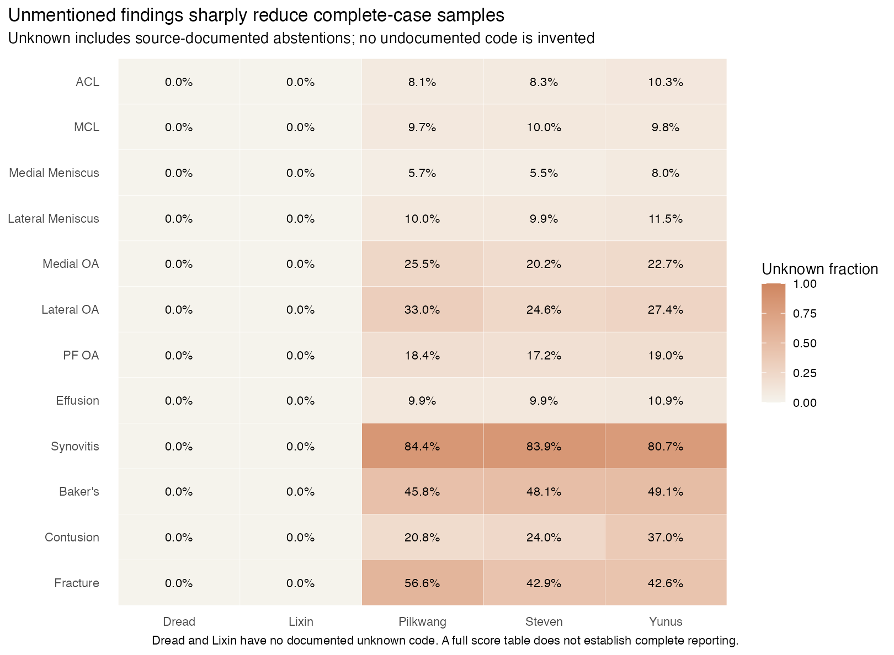
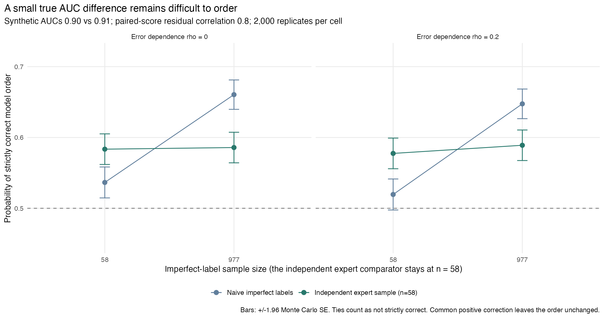
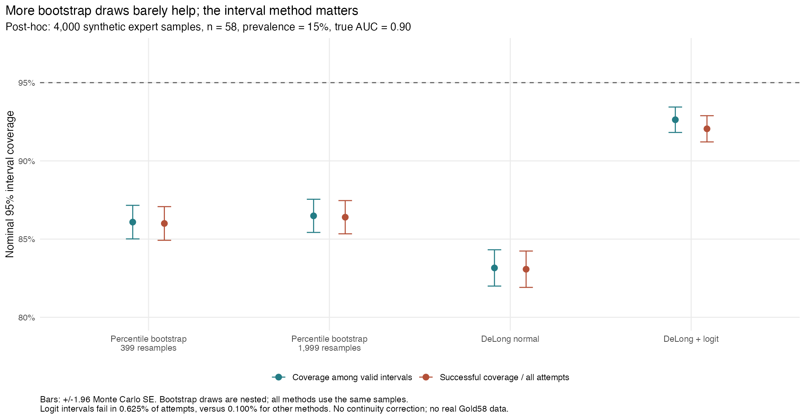

## What I found

1. **Definition differences explain most of the disagreement between Pilkwang and Yunus, indicating that the original two-group structure was at least partly shaped by coding.** Yunus's mild code 0.25 had been counted negative under the original 0.5 threshold. Aligning the two documented sources on identical paired cases raises effusion agreement from 60.2% to 99.5% (κ 0.31 to 0.99) and synovitis agreement from 68.4% to 98.7%. They belonged to different original groups; the other three sources lack sufficient documentation for alignment. Original clustering and latent-model misfit motivated this investigation rather than establishing distinct independent extraction families.
2. **Majority-vote references can favour models sharing the majority's labelling style.** At equal full-population true AUC, the primary scenario favours the model that learned the Steven/Pilkwang/Lixin labelling style in 10 of 12 findings; both meniscus findings favour B. No-inheritance controls give selection near 50%, and swapping inherited groups reverses the direction. This demonstrates a possible mechanism conditional on the generator, not the size or occurrence of bias in the real competition. Group filtering changes both evaluated cases and their true model ordering, so it is not a general remedy.
3. **Corrections that assume label errors are independent of model scores can fail badly when errors are shared.** In the original score-dependent simulation, known-parameter correction at n=977 has bias +0.1274 and nominal 95% interval coverage of 12.4%; with score-independent errors it removes most bias. The relevant independence assumption is conditional on the true class. These results concern that correction and mechanism, not all statistical corrections.

The sections below report the definition-alignment and majority-vote analyses added after the first results, followed by the original agreement, clustering, latent-model diagnostics and correction simulations. All previously obtained numerical results are retained.

## Design and provenance

I froze the original [analysis plan](analysis/SAP.md) before the primary agreement, latent-model and correction outcomes. Clustering, interval-method comparisons and v1.4 were exploratory additions after earlier results; the [research decisions](analysis/DECISIONS.md) record their sequence. The new alignment and consensus-selection simulations use the existing five public label files and do not alter the original outputs.

I used Dread v3, Steven v6's original full/v1 file, Pilkwang v1, Yunus v3 and Lixin v1. Each publisher lists CC0. See the [source audit](analysis/SOURCE_AUDIT.md) and [file hashes](results/source_files.csv). All five primary files cover the Dread-anchored intersection. This is a cohort of study identifiers, not a confirmed count of unique patients.

I analyzed public extraction tables and excluded known later blends from the primary cohort. I used no original reports, MRI images, official Gold58 annotations, personal model predictions, submission histories or rule-gated files.

## Definition alignment and majority-vote analyses added after the first results

I mapped only rules supported by public publisher documentation: Pilkwang YES/NO/UNK becomes positive/negative/missing; Yunus's documented 0.25, 0.55 and 0.90–1 codes count positive for any affirmed abnormality, while 0 is negative and unmentioned/uncertain codes remain missing. Three undocumented Yunus values remain missing. This common report-assertion target includes mild findings; it is not imaging-confirmed disease.

Only Pilkwang and Yunus support this documented alignment, so no new latent-class model is fitted. For moderate-or-greater, only Yunus qualifies; its positive fraction is unchanged from the original coding on identical known cases. Steven, Dread and Lixin retain their original operational codes only in explicitly non-harmonized context. See the [complete mapping](analysis/v1.4/DEFINITION_MAPPING.md), [120-row specification](analysis/v1.4/definition-map.csv), [source-document evidence](analysis/v1.4/source-documents.csv) and [run guide](analysis/v1.4/RUN.md).

### Documented alignment on identical paired samples

| Finding | Same paired n | Before | After | Change, pp (95% bootstrap interval) | Kappa before → after |
| --- | --- | --- | --- | --- | --- |
| ACL | 3887 | 91.1% | 99.2% | +8.1 (+7.3, +9.0) | 0.756 → 0.980 |
| MCL | 3890 | 88.0% | 99.4% | +11.4 (+10.3, +12.4) | 0.481 → 0.979 |
| Medial Meniscus | 3990 | 90.0% | 97.0% | +7.0 (+5.9, +8.0) | 0.802 → 0.939 |
| Lateral Meniscus | 3817 | 91.7% | 98.0% | +6.3 (+5.4, +7.3) | 0.765 → 0.950 |
| Medial OA | 3035 | 81.5% | 98.4% | +16.8 (+15.4, +18.3) | 0.635 → 0.967 |
| Lateral OA | 2690 | 82.1% | 97.6% | +15.5 (+14.0, +17.0) | 0.593 → 0.950 |
| PF OA | 3356 | 80.1% | 98.3% | +18.1 (+16.7, +19.6) | 0.617 → 0.964 |
| Effusion | 3858 | 60.2% | 99.5% | +39.4 (+37.8, +40.9) | 0.311 → 0.989 |
| Synovitis | 599 | 68.4% | 98.7% | +30.2 (+26.4, +34.0) | 0.252 → 0.916 |
| Baker's | 2195 | 80.9% | 98.8% | +17.9 (+16.3, +19.6) | 0.617 → 0.976 |
| Contusion | 2633 | 76.7% | 91.0% | +14.2 (+12.3, +16.1) | 0.506 → 0.820 |
| Fracture | 1485 | 98.0% | 99.4% | +1.3 (+0.8, +2.0) | 0.928 → 0.978 |

Intervals use 2,000 joint study-bootstrap draws; all change estimates have 2,000 valid draws. Pilkwang's verdict coding is unchanged. The principal change is that Yunus's documented mild code 0.25 becomes positive. For effusion, disagreement falls from 39.8% to 0.5%; for synovitis from 31.6% to 1.3%. This is evidence that these sources were answering different operational questions under the original threshold. High post-alignment agreement does not establish correct diagnosis, independent errors, or generalizability beyond the observed known pairs. Contusion retains the largest residual disagreement, about 9%.

Full positive-fraction changes and known/excluded counts are in [paired changes](results/v1.4/alignment-paired-changes.csv) and [denominators](results/v1.4/alignment-denominators.csv). [Five-source context](results/v1.4/nonharmonized-five-source-context.csv) remains explicitly non-harmonized.

### Simulation design and all 13 scenarios

G1 = Steven/Pilkwang/Lixin; G2 = Dread/Yunus. A inherits G1 style and B G2 style, except in the swap control. No participant model is trained or evaluated. The generator preserves each finding's original five-source-complete **joint label-pattern distribution** in expectation. Hypothetical truth and score-error relationships are added as assumptions; the score construction sets each model's full-population true AUC exactly. Parameters are not taken from the rejected latent fits.

The three primary scenarios are A/B true AUC = **0.85/0.85**, **0.86/0.85**, and **0.85/0.86**, with inheritance variance 0.5, equal group weight in the truth mechanism, truth slope 4, and prevalence multiplier 1. Each has 2,000 replicates per finding. Ten prespecified sensitivities (1,000 replicates each) vary inheritance, swap the inherited group, and vary the assumed truth mechanism/prevalence. See [all 13 scenario rows](analysis/v1.4/SIMULATION_SCENARIOS.md) and [exact generator](analysis/v1.4/SAP-v1.4.md#5-empirically-constrained-simulation-generator).

The population is the original complete-label subset (573–3,987 studies per finding), not all 4,349 reports. The prevalence anchor is a scenario proxy, not an estimate of disease prevalence. Clusters were discovered under the original operational coding; the large alignment effect warns that some apparent cluster structure may reflect definitions. The simulation therefore describes risks of using those **original** labels as a reference, not an inevitable property of a fully harmonized dataset.

| Scenario | AUC A | AUC B | Inheritance variance | A inherits | Truth weight G1 | Truth slope | Prevalence multiplier | Replicates |
| --- | --- | --- | --- | --- | --- | --- | --- | --- |
| equal_true_auc | 0.85 | 0.85 | 0.5 | G1 | 0.5 | 4 | 1 | 2000 |
| A_better | 0.86 | 0.85 | 0.5 | G1 | 0.5 | 4 | 1 | 2000 |
| B_better | 0.85 | 0.86 | 0.5 | G1 | 0.5 | 4 | 1 | 2000 |
| no_inheritance | 0.85 | 0.85 | 0 | G1 | 0.5 | 4 | 1 | 1000 |
| weak_inheritance | 0.85 | 0.85 | 0.25 | G1 | 0.5 | 4 | 1 | 1000 |
| strong_inheritance | 0.85 | 0.85 | 0.75 | G1 | 0.5 | 4 | 1 | 1000 |
| swap_training_groups | 0.85 | 0.85 | 0.5 | G2 | 0.5 | 4 | 1 | 1000 |
| truth_favors_group1 | 0.85 | 0.85 | 0.5 | G1 | 0.75 | 4 | 1 | 1000 |
| truth_favors_group2 | 0.85 | 0.85 | 0.5 | G1 | 0.25 | 4 | 1 | 1000 |
| weak_truth_alignment | 0.85 | 0.85 | 0.5 | G1 | 0.5 | 2 | 1 | 1000 |
| strong_truth_alignment | 0.85 | 0.85 | 0.5 | G1 | 0.5 | 8 | 1 | 1000 |
| lower_prevalence | 0.85 | 0.85 | 0.5 | G1 | 0.5 | 4 | 0.5 | 1000 |
| higher_prevalence | 0.85 | 0.85 | 0.5 | G1 | 0.5 | 4 | 1.5 | 1000 |

### Direct-majority mechanism controls

All points use unchanged simulation outputs. The no-inheritance control spans P(A)=47.1%–51.7%; the primary inherited-style scenario favours A in ten findings, with medial and lateral meniscus favouring B (P(A)=28.75% and 36.15%). Swapping the inherited groups reverses these directions, including the meniscus exceptions. The assumed inheritance variance is 0 for the no-inheritance control and 0.5 for the other two scenarios. These controls illustrate the mechanism; they do not establish actual competition bias or estimate its magnitude.

### Equal underlying quality: full and retained results

Both full-population true AUCs are 0.85, so there is no intrinsically worse model. P(A) measures selection preference. Ref ΔAUC is A minus B against the reference; truth ΔAUC is against simulated truth on the same retained cases. Retained n in the table is the observed calibration count; simulated mean n and MCSE are separately reported in [DGM summaries](results/v1.4/simulation-dgm.csv).

| Finding | Complete n | Observed retained n (%) | P(A), full | P(A), retained | Ref ΔAUC, full | Ref ΔAUC, retained | Truth ΔAUC, retained |
| --- | --- | --- | --- | --- | --- | --- | --- |
| ACL | 3873 | 3482 (89.9%) | 100.0% | 2.1% | +0.043 | -0.015 | -0.010 |
| MCL | 3863 | 3375 (87.4%) | 100.0% | 0.8% | +0.170 | -0.026 | -0.021 |
| Medial Meniscus | 3987 | 3388 (85.0%) | 28.7% | 75.8% | -0.003 | +0.004 | +0.002 |
| Lateral Meniscus | 3808 | 3348 (87.9%) | 36.1% | 45.6% | -0.003 | -0.001 | -0.001 |
| Medial OA | 3020 | 2377 (78.7%) | 100.0% | 1.2% | +0.077 | -0.015 | -0.013 |
| Lateral OA | 2665 | 2107 (79.1%) | 100.0% | 0.3% | +0.101 | -0.021 | -0.018 |
| PF OA | 3329 | 2603 (78.2%) | 100.0% | 1.6% | +0.070 | -0.015 | -0.012 |
| Effusion | 3856 | 2262 (58.7%) | 100.0% | 8.4% | +0.149 | -0.009 | -0.008 |
| Synovitis | 573 | 354 (61.8%) | 100.0% | 58.5% | +0.097 | +0.005 | +0.018 |
| Baker's | 2164 | 1602 (74.0%) | 100.0% | 0.2% | +0.101 | -0.023 | -0.020 |
| Contusion | 2453 | 1786 (72.8%) | 100.0% | 0.6% | +0.059 | -0.020 | -0.014 |
| Fracture | 1306 | 1199 (91.8%) | 95.0% | 3.6% | +0.024 | -0.026 | -0.016 |

Direct majority favors the model that learned the Steven/Pilkwang/Lixin labelling style in **10 of 12 findings**, but favors B for both menisci. Under the primary effusion scenario, A is selected in all 2,000 direct-majority replicates despite equal true AUC; after retaining only group-agreement cases, A is selected 8.4% of the time. These are results conditional on the specified assumptions, not estimates of actual participant bias. A 100% Monte Carlo result is not proof of certainty.

Filtering retains 58.7%–91.8% of the complete-label subset, hence abstains on 8.2%–41.3%. For effusion it retains 2,262 of 3,856 complete cases; for synovitis 354 of 573, only 8.1% of the original 4,349 studies. G2 ties and between-group disagreement are reported separately in [cohort calibration](results/v1.4/simulation-cohort.csv).

On the common retained cases, direct-majority and group-agreement reference labels are identical, so their AUCs and selected models coincide.

### AUC distortion and filtering's selection effect

The following is mean(reference AUC − synthetic-truth AUC) on identical evaluated cases, in the equal-true-AUC scenario. It isolates label-reference distortion from population selection. Exact MCSEs and valid denominators are in [the complete summary](results/v1.4/simulation-summary.csv).

| Finding | Full bias A | Full bias B | Retained bias A | Retained bias B |
| --- | --- | --- | --- | --- |
| ACL | +0.060 | +0.017 | +0.065 | +0.069 |
| MCL | +0.051 | -0.119 | +0.079 | +0.085 |
| Medial Meniscus | +0.052 | +0.055 | +0.055 | +0.053 |
| Lateral Meniscus | +0.058 | +0.061 | +0.068 | +0.067 |
| Medial OA | +0.054 | -0.023 | +0.042 | +0.044 |
| Lateral OA | +0.050 | -0.051 | +0.048 | +0.051 |
| PF OA | +0.057 | -0.013 | +0.040 | +0.043 |
| Effusion | +0.050 | -0.099 | +0.030 | +0.031 |
| Synovitis | +0.085 | -0.012 | +0.051 | +0.064 |
| Baker's | +0.050 | -0.051 | +0.042 | +0.045 |
| Contusion | +0.043 | -0.015 | +0.056 | +0.062 |
| Fracture | +0.061 | +0.036 | +0.068 | +0.079 |

For example, effusion's full-sample reference AUC is biased by about +0.050 for A and −0.099 for B. Filtering reduces this differential but leaves about +0.030/+0.031 label-reference bias. It also changes conditional true AUCs: equal full-population AUC does not require equal performance in the retained subset. The files separately report `selection_effect = truth AUC on evaluated cases − full-population target` and `total_bias = label_bias + selection_effect`; this decomposition was checked per replicate.

### Unequal true AUC: model selection

Error here means choosing the lower **full-population** true-AUC model. The retained subset can have a different true ordering, so this is distinct from disagreement with the synthetic-truth ranking on the same realized test sample. Both endpoints, ties, failures and paired contrasts are supplied.

| Finding | A better: full error | A better: retained error | B better: full error | B better: retained error |
| --- | --- | --- | --- | --- |
| ACL | 0.0% | 93.5% | 100.0% | 0.5% |
| MCL | 0.0% | 99.0% | 100.0% | 0.3% |
| Medial Meniscus | 41.5% | 8.1% | 10.8% | 49.4% |
| Lateral Meniscus | 46.0% | 35.1% | 21.3% | 27.8% |
| Medial OA | 0.0% | 94.8% | 100.0% | 0.3% |
| Lateral OA | 0.0% | 98.4% | 100.0% | 0.1% |
| PF OA | 0.0% | 94.0% | 100.0% | 0.3% |
| Effusion | 0.0% | 80.5% | 100.0% | 3.8% |
| Synovitis | 0.0% | 34.4% | 100.0% | 55.1% |
| Baker's | 0.0% | 98.9% | 100.0% | 0.2% |
| Contusion | 0.0% | 98.2% | 100.0% | 0.2% |
| Fracture | 2.6% | 95.2% | 91.5% | 1.7% |

Filtering is not a universal improvement. For effusion, when B's true AUC is 0.86 versus A's 0.85, error falls from 100.0% to 3.8%; when A is better by the same amount, error rises from 0.0% to 80.5%. Some of this reversal reflects a different conditional true ordering after selection. Those counterexamples are part of the result. The [paired contrasts](results/v1.4/simulation-paired-contrasts.csv) give paired MCSEs and valid denominators rather than treating the methods' simulations as independent.

### Specified sensitivities and Monte Carlo precision

| Equal-AUC sensitivity | P(A) range, full | P(A) range, retained | Findings P(A)>50%, full /12 | Retained /12 |
| --- | --- | --- | --- | --- |
| no_inheritance | 47.1%–51.7% | 46.9%–51.5% | 5 | 4 |
| weak_inheritance | 38.9%–100.0% | 3.2%–67.9% | 10 | 2 |
| strong_inheritance | 16.4%–100.0% | 0.0%–80.1% | 10 | 2 |
| swap_training_groups | 0.0%–70.7% | 23.7%–99.7% | 2 | 10 |
| truth_favors_group1 | 26.6%–100.0% | 0.0%–67.6% | 10 | 1 |
| truth_favors_group2 | 34.2%–100.0% | 2.5%–82.0% | 10 | 4 |
| weak_truth_alignment | 35.9%–100.0% | 0.5%–76.0% | 10 | 3 |
| strong_truth_alignment | 23.5%–100.0% | 0.0%–78.1% | 10 | 2 |
| lower_prevalence | 32.5%–100.0% | 0.4%–70.0% | 10 | 2 |
| higher_prevalence | 32.5%–100.0% | 0.6%–81.0% | 10 | 3 |

Ranges summarize twelve heterogeneous findings; they do not pool them as independent clinical replications. Without inherited group errors, P(A) stays near 50% (47.1%–51.7% full; 46.9%–51.5% retained), providing a useful control. Swapping model-group inheritance reverses the broad direction. Changing truth assumptions changes magnitudes and sometimes directions. These controls show why the data alone cannot identify real evaluation bias.

All **156 cells and 192,000 attempted replicates** completed. No reference AUC or synthetic-truth AUC failed; ranking ties are separately counted. Primary probability MCSE is at most about 1.12 percentage points (2,000 draws), sensitivity MCSE at most 1.58 points (1,000 draws). The run used 4.39 minutes; recorded cumulative statistical compute including original runs is about 9.03 minutes, below the 120-minute cap. See [run record](results/v1.4/simulation-run.json) and [software checks](results/v1.4/software-checks.csv).

The [practical evidence table](results/v1.4/practical-evidence-table.csv) records aligned agreement, paired coverage, complete/retained population coverage and a use-before-validation recommendation for each finding. The [project overview](README.md#practical-use) presents a concise version.

## Original analyses under the original operational coding

The following original tables and diagnostics retain their original numerical results. Their two-group pattern is conditional on that coding; the documented alignment above supersedes an interpretation of the groups as stable across target definitions. Alignment of one cross-group pair does not show that all five definitions can be reconciled, or that the original latent model would fit after full harmonization.

## Agreement between label sources

Pilkwang YES/NO/UNK verdicts map to positive/negative/missing. Steven's documented 0.5 and Yunus's 0.05/0.5 are missing. Dread and Lixin use a 0.5 score threshold because no special unknown convention is documented. Different thresholds for severity and mention can encode different target constructs. Scores are not assumed calibrated probabilities.

Pairwise analyses use paired known observations; Fleiss kappa and the latent model use studies known in all five sources for each finding. Study bootstrap intervals use 2,000 joint resamples. Repeated examinations cannot be clustered by patient because patient identifiers are unavailable. The intervals may therefore be too narrow. Complete-case selection may be informative.

|Finding          | Complete studies|Fleiss kappa |95% bootstrap interval |
|:----------------|----------------:|:------------|:----------------------|
|ACL              |             3873|0.794        |0.779 to 0.810         |
|MCL              |             3863|0.660        |0.638 to 0.682         |
|Medial Meniscus  |             3987|0.795        |0.781 to 0.807         |
|Lateral Meniscus |             3808|0.758        |0.740 to 0.776         |
|Medial OA        |             3020|0.761        |0.744 to 0.777         |
|Lateral OA       |             2665|0.733        |0.714 to 0.751         |
|PF OA            |             3329|0.764        |0.749 to 0.781         |
|Effusion         |             3856|0.517        |0.499 to 0.535         |
|Synovitis        |              573|0.390        |0.325 to 0.453         |
|Baker's          |             2164|0.708        |0.689 to 0.729         |
|Contusion        |             2453|0.605        |0.583 to 0.626         |
|Fracture         |             1306|0.868        |0.845 to 0.889         |

For example, fracture agreement is high, while synovitis has much lower agreement and only 573 complete studies.

[Agreement summaries](results/T4_agreement.csv) include Cohen kappa, PABAK, apparent positive/unknown fractions, Fleiss kappa, and joint/phi correlations of leave-one-source-out majority disagreements. [Source denominators](results/T4_denominators.csv) and [paired denominators](results/T4_pair_denominators.csv) accompany them. Majority disagreements are **not errors against truth**; shared majority definitions can themselves induce correlation. These summaries do not identify conditional error dependence.

[Prespecified sensitivities](results/T4_sensitivity.csv) vary score thresholds to 0.3/0.7 and treat documented unknowns as negative/positive. These change the definition and analyzed population; none was selected to maximize agreement.

## Similarity between sources: exploratory clustering

After inspecting the pairwise agreement heatmap, I clustered sources using [average linkage](https://stat.ethz.ch/R-manual/R-devel/library/stats/html/hclust.html) and `1 - mean(Cohen kappa)` across the 12 equally weighted findings. The two-cluster cut was chosen after viewing the heatmap, rather than selected by an independence test. A median-kappa sensitivity and a mean-kappa analysis restricted to the same five-source-complete cases for each finding yield the same groups. All 1,000 joint study-bootstrap samples retain the two-cluster partition.

The 12-finding mean pairwise kappas are 0.955 for Steven/Pilkwang, 0.881 for Steven/Lixin, 0.865 for Pilkwang/Lixin, and 0.793 for Dread/Yunus. Kappa reaches at least 0.9 in 10, 9 and 7 of 12 findings for the three pairs in the first group, respectively. It is not uniformly near-perfect agreement across all findings.

|Finding   |Pair              | Paired known|Kappa |95% bootstrap interval |
|:---------|:-----------------|------------:|:-----|:----------------------|
|Effusion  |Dread / Lixin     |         4349|0.377 |0.358 to 0.398         |
|Effusion  |Dread / Pilkwang  |         3917|0.325 |0.307 to 0.345         |
|Effusion  |Dread / Steven    |         3919|0.330 |0.311 to 0.349         |
|Effusion  |Dread / Yunus     |         3874|0.894 |0.878 to 0.910         |
|Effusion  |Pilkwang / Lixin  |         3917|0.970 |0.962 to 0.978         |
|Effusion  |Pilkwang / Yunus  |         3858|0.311 |0.292 to 0.330         |
|Effusion  |Steven / Lixin    |         3919|0.973 |0.966 to 0.980         |
|Effusion  |Steven / Pilkwang |         3913|0.989 |0.983 to 0.993         |
|Effusion  |Steven / Yunus    |         3861|0.315 |0.296 to 0.334         |
|Effusion  |Yunus / Lixin     |         3874|0.321 |0.302 to 0.341         |
|Synovitis |Dread / Lixin     |         4349|0.304 |0.272 to 0.338         |
|Synovitis |Dread / Pilkwang  |          678|0.309 |0.254 to 0.365         |
|Synovitis |Dread / Steven    |          701|0.391 |0.337 to 0.448         |
|Synovitis |Dread / Yunus     |          839|0.736 |0.687 to 0.781         |
|Synovitis |Pilkwang / Lixin  |          678|0.866 |0.815 to 0.912         |
|Synovitis |Pilkwang / Yunus  |          599|0.252 |0.195 to 0.309         |
|Synovitis |Steven / Lixin    |          701|0.931 |0.896 to 0.962         |
|Synovitis |Steven / Pilkwang |          605|1.000 |1.000 to 1.000         |
|Synovitis |Steven / Yunus    |          589|0.275 |0.217 to 0.335         |
|Synovitis |Yunus / Lixin     |          839|0.507 |0.454 to 0.561         |

Effusion within-group kappa is 0.894–0.989, versus 0.311–0.377 between groups. Synovitis is less cleanly separated: Dread/Yunus kappa is 0.736 and Yunus/Lixin reaches 0.507. Steven/Pilkwang kappa=1 concerns **605 paired-known, thresholded binary labels**, not complete-file identity, unknown codes or continuous scores. Its [1,1] empirical bootstrap interval reflects zero observed discordance; it does not establish perfect population agreement.

The [post-hoc provenance review](analysis/SOURCE_AUDIT.md#post-hoc-provenance-review-2026-10-29) identifies a concrete definition difference: Pilkwang's YES verdict denotes an asserted finding, whereas Yunus's mild/trace score of 0.25 falls below the primary 0.5 threshold. Steven's later v4 file explicitly blends with Lixin, but **the selected Steven file is original v1**, so that relationship cannot establish copying among these primary files. Lixin's empty description leaves important provenance unknown.

I use the cluster structure to motivate a closer examination of source conventions and model fit, rather than treating five agreeing labels as five independent confirmations.

[Cluster pair summaries](results/T5_clusters.csv), [memberships](results/T5_membership.csv) and [finding-specific denominators](results/T5_focus.csv) provide the aggregate record.

## Testing a no-gold-standard model

The model has two latent report-state classes and five conditionally independent Bernoulli indicators. Beta(2,2) accuracy priors and Beta(1,1) prevalence priors are constrained to a positive average Youden index to orient the classes. Four chains start with 6,000 iterations and 2,000 warmup, with one prespecified extension to 12,000/4,000. The [posterior package diagnostics](https://mc-stan.org/posterior/reference/diagnostics.html) use rank-normalized R-hat and bulk/tail ESS. Accuracy-prior sensitivities are Beta(1,1) and Beta(4,2).

Of 12 primary fits, **11 pass** R-hat <1.01 and bulk/tail ESS >=400. Synovitis still fails after extension (maximum R-hat 1.528, minimum bulk ESS 7.1). Its pooled quantiles are saved for diagnostics only and are not valid credible intervals. A more optimistic prior yields converged synovitis chains, which does not justify switching to that prior after observing the failure.

For each of the 11 converged primary fits, **none of 2,000 posterior predictive replicates** reached the observed response-pattern discrepancy. This is a simulation count, not an exact zero probability. The discrepancy is a Pearson-type pattern statistic with expected count +0.5 in the denominator. Many parameters approach their boundaries. Good chain diagnostics cannot establish model fit or identifiability.

The data challenge the combined assumptions of a common binary construct and conditional independence. They do not identify which mechanism explains the mismatch. Shared text, shared extraction conventions and residual source dependence are plausible explanations, not separately estimated causes.

The [parameter-draw summaries](results/T6_latent_parameters.csv), [predictive checks](results/T6_predictive_checks.csv), and [response-pattern summaries](results/T6_pattern_checks.csv) are diagnostic outputs. I retain these estimates as model diagnostics and use the prespecified parameter grid for the misclassification simulations. A dependent latent model was not fitted. Even a better-fitting report model could not identify the shared discrepancy between reports and imaging truth without additional evidence.

## How label errors bias AUC

This is a prespecified four-cell simulation: n=58/977 and label-error dependence rho=0/0.2. True AUCs are 0.90 and 0.91, prevalence 0.15, Se=Sp=0.85, and paired-score residual correlation 0.8. Rho denotes the latent Gaussian correlation between each score residual and the label-generating residual, conditional on the true class. It represents score–label dependence, whereas the source comparison examines label–label agreement. Sample sizes are scenario choices; n=977 is not asserted to be an official test-set count.

Each cell has 2,000 replicates and 399 paired bootstrap resamples per interval. An interval requires at least 80% valid resamples. All cells meet bias MCSE <0.005 for the implemented estimands and methods. [Generating-mechanism checks](results/T7_dgm.csv) report realized marginal parameters.

Under score-independent misclassification,

`AUC_imperfect = 0.5 + (PPV + NPV - 1) × (AUC_true - 0.5)`.

The oracle correction uses the true Se, Sp and prevalence; its scale factor is 0.4698 in this scenario. It does not include uncertainty from estimating these parameters. Corrected AUCs are deliberately not clipped to [0,1]. The expert comparator is a separately generated, perfectly labeled sample of size 58—not actual Gold58.

|   n| rho|Method            |Bias    |Bias MCSE |Empirical SD |95% CI coverage |Out of range |
|---:|---:|:-----------------|:-------|:---------|:------------|:---------------|:------------|
|  58| 0.0|Naive             |-0.2115 |0.0020    |0.0885       |23.8%           |0.0%         |
|  58| 0.0|Oracle correction |0.0012  |0.0042    |0.1885       |92.9%           |30.0%        |
|  58| 0.2|Naive             |-0.1513 |0.0018    |0.0796       |48.1%           |0.0%         |
|  58| 0.2|Oracle correction |0.1294  |0.0038    |0.1695       |84.4%           |59.2%        |
| 977| 0.0|Naive             |-0.2124 |0.0005    |0.0210       |0.0%            |0.0%         |
| 977| 0.0|Oracle correction |-0.0006 |0.0010    |0.0447       |94.5%           |1.2%         |
| 977| 0.2|Naive             |-0.1522 |0.0004    |0.0183       |0.0%            |0.0%         |
| 977| 0.2|Oracle correction |0.1274  |0.0009    |0.0391       |12.4%           |75.7%        |

At rho=0, increasing n from 58 to 977 reduces the corrected estimator's SD from **0.1885 to 0.0447**, with little remaining bias. At rho=0.2 and n=977, the same formula has bias **+0.1274** (MCSE 0.0009), only **12.4%** coverage (MCSE 0.74 percentage points), and **75.7%** of corrected AUCs exceed the allowed range. This illustrates model failure, not evidence of an AUC above one.

The independent expert n=58 estimator has little mean bias here, but its percentile-bootstrap coverage is only **84.9–86.5%**, below the nominal 95%. Small positive counts and occasional undefined/failed intervals are part of the result. An unbiased point estimate does not ensure a reliable interval. Full results for both model AUCs and their paired difference, including bias, RMSE, precision, coverage, failures and MCSEs are in [simulation results](results/T7_simulation.csv); coverage is conditional on a valid interval, and interval failures are reported separately.

At rho=0, strict correct ordering of the 0.90/0.91 models rises from **53.65%** at n=58 to **66.05%** at n=977 (MCSE approximately 1.1 percentage points). Multiplying both estimates by the same positive correction factor cannot change their order; it only rescales the paired difference. [Ordering outputs](results/T7_ordering.csv) include ties and reversals.

## Small expert samples: an exploratory interval comparison

The original simulations used 399 percentile-bootstrap resamples. To separate bootstrap Monte Carlo resolution from interval-method limitations, I generated **4,000 additional, perfectly labeled synthetic samples**, each n=58, prevalence 0.15 and true AUC 0.90. Every method sees the same samples; the first 399 bootstrap draws are nested within 1,999 draws. Error dependence rho is irrelevant to this perfectly labeled experiment. The original four-cell correction analysis and its outputs are unchanged.

DeLong variance is calculated from case/control placements and checked against [pROC](https://cran.r-project.org/web/packages/pROC/refman/pROC.html). Normal intervals are clipped to [0,1]; logit-delta intervals transform using the same variance. These are asymptotic intervals, not exact finite-sample procedures. At least two observations in each class are required for DeLong; AUC at a boundary or zero variance makes the logit interval undefined, without an invented continuity correction. Bootstrap intervals still require 80% valid resamples.

|Method         | Valid intervals|Coverage (valid) |Coverage MCSE (pp) |Successful coverage (all) |Failure rate |Mean width |
|:--------------|---------------:|:----------------|:------------------|:-------------------------|:------------|:----------|
|bootstrap_399  |            3996|86.09%           |0.55               |86.00%                    |0.100%       |0.203      |
|bootstrap_1999 |            3996|86.49%           |0.54               |86.40%                    |0.100%       |0.204      |
|delong_normal  |            3996|83.16%           |0.59               |83.08%                    |0.100%       |0.194      |
|delong_logit   |            3975|92.63%           |0.41               |92.05%                    |0.625%       |0.228      |

Increasing bootstrap draws changes successful coverage over all attempts by **+0.40 percentage points** (paired MCSE 0.19 pp). Logit intervals improve it by **+6.05 pp** (paired MCSE 0.48 pp), but remain below nominal coverage: 92.63% among valid intervals, **92.05% across all attempts**. Ordinary DeLong reaches only 83.16% among valid intervals. A method called DeLong is not automatically better in this sparse setting.

The samples average 8.74 positives (central 95% range 4–14). There are 4 samples with fewer than two positives and 21 with boundary AUC/zero DeLong variance. The logit method therefore fails in 25/4,000 attempts; other methods fail in 4/4,000. Undefined intervals count as unsuccessful in the all-attempt measure rather than disappearing from the denominator. Conditional coverage alone would hide this tradeoff.

The [interval-method results](results/T8_interval_sensitivity.csv) include paired MCSEs and width; [sample diagnostics](results/T8_sample_diagnostics.csv) record class counts and boundary cases.

## Limitations

I can describe agreement within this cohort but cannot establish imaging accuracy without an independent reference standard. Shared report-to-image errors are unidentifiable here. Several publishers describe expert-panel benchmarking, and incomplete provenance prevents me from excluding undisclosed tuning or label reuse.

High marginal agreement can arise from a common true state even under conditional independence. Different targets and shared extraction errors can also explain model misfit; neither clustering nor predictive checks isolate the mechanism. I therefore treat cluster stability as descriptive and do not estimate an effective number of independent sources or rank sources by latent-model accuracy.

Missing labels create different comparison populations, and repeated examinations may narrow study-bootstrap intervals when patient identifiers are unavailable. The simulations demonstrate behavior under specified mechanisms, rather than clinical performance or results on the actual Gold58 panel. The interval comparison shows little improvement from more bootstrap draws but does not isolate the contributions of sparse positives, discreteness, skewness and the generating distribution.

I completed the public-source agreement analysis, independent latent-model checks and four baseline misclassification scenarios. Secondary derivative-source analyses, alternate prevalence priors/orientations, a dependent latent model, extraction-error-only simulations informed by the latent model, uncertain-parameter correction, and the large stress grid were not run. I retained the prespecified simulation parameters because the latent model could not provide a credible calibration.

Only two sources support documented alignment, and their agreement is not diagnostic accuracy. The simulations use assumed latent truth and score-style inheritance; their magnitudes do not estimate actual participant bias. The definition-alignment and majority-vote analyses were added after the first results, and their plan files were not fully uploaded before execution ([publication record](analysis/v1.4/FREEZE_DEVIATION.md)).

This completes the project: the analysis includes documented two-source alignment and all 156 specified consensus-selection cells; no additional analysis is planned.

## Reproduction and references

The [R execution guide](analysis/README.md), [checks](analysis/CHECKS.md), and [method references](analysis/SAP.md#references) document reproduction. Agreement computation took 0.11 minutes, latent fitting 1.07 minutes, and misclassification simulations 1.76 minutes. Clustering took 0.02 minutes and interval comparison 0.31 minutes. Those earlier analyses used about 4.55 minutes; with v1.4 alignment and all 192,000 consensus-selection replicates, recorded cumulative statistical computation is about 9.03 minutes, within the 120-minute cap ([v1.4 run record](results/v1.4/simulation-run.json)). Software tests and rendering are recorded separately. I keep raw labels, study IDs and simulation draws outside the repository and publish aggregate tables and figures.

The source audit records the upstream authors who supplied the label extractions.
